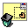

  

<h1 align="center">Kiru</h1>

  
  
  
  

Repliman is a small legacy Haiku/BeOS utility for listing and removing stubborn desktop and deskbar replicants—those little app fragments that can get stuck in the desktop or Deskbar and refuse to go away cleanly. It is a native C++ application built against the classic Be API, with a simple window that refreshes running replicants and lets the user delete the selected one.
